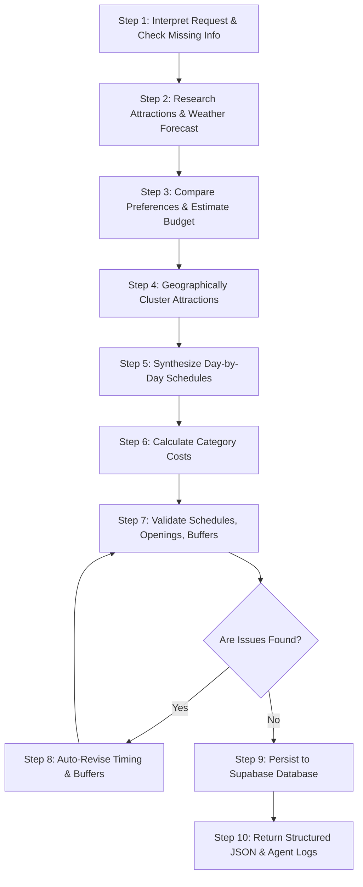

# TripPilot AI - Agentic Travel Planner Specification

> **Module**: [`backend/src/agent/`](file:///D:/skills_lab/Travel_planner/backend/src/agent/)  
> **Orchestrator**: [`backend/src/agent/orchestrator.ts`](file:///D:/skills_lab/Travel_planner/backend/src/agent/orchestrator.ts)  
> **LLM Provider**: Google Gemini (`@google/genai` & OpenAI-compatible endpoint)  
> **Tool Registry**: [`backend/src/agent/tools/`](file:///D:/skills_lab/Travel_planner/backend/src/agent/tools/)  

---

## 1. Architectural Philosophy

TripPilot AI employs a **deterministic-augmented agentic architecture**:
1. **Real Tool Calling**: The agent doesn't guess or fabricate coordinates, weather forecasts, or distance durations; it invokes real tool adapters and consumes their outputs.
2. **Deterministic Feasibility Guarantees**: A strict algorithmic validator evaluates time overlaps, venue opening hours, and travel buffers, triggering automatic revision if problems are flagged.
3. **Resilience / Fallback Safety**: If external APIs or LLM keys are absent in development, a deterministic heuristic orchestrator executes all tools with 100% fidelity, allowing tests and frontend integration to run uninterrupted.

---

## 2. The 10-Step Planning Loop

### Detailed Step Breakdown:
1. **Interpret**: Sanitizes inputs (prevents prompt injection), checks date chronologies, computes duration days, and validates traveler counts.
2. **Research**: Calls `search_places` and `get_weather_forecast` in parallel for the destination coordinates.
3. **Estimate Budget**: Calls `estimate_trip_budget` to compute realistic category spending (lodging, dining, activities, transport, contingency buffer) and identifies surpluses or deficits.
4. **Geographic Clustering**: Organizes attractions by latitude/longitude proximity so travelers don't spend unnecessary hours crossing the city.
5. **Synthesize Days**: Allocates morning sightseeing, artisanal lunch, afternoon cultural exploration, and evening dining/strolls with realistic duration blocks.
6. **Cost Aggregation**: Tallies ticket prices and meals per day, providing a total estimated cost.
7. **Validation**: Passes the planned itinerary through `ItineraryValidator.validate`.
8. **Revision**: If overlaps or unrealistic walking times are found, shifts start/end times and inserts appropriate transit buffers automatically.
9. **Persistence**: Calls `save_trip` to atomically write the trip, days, activities, accommodation, and expenses into Supabase.
10. **Delivery**: Marks the `agent_runs` record `completed` (100% progress) and returns the JSON payload to the caller.

---

## 3. The 10 Callable Tools

All tools are declared in [`backend/src/agent/tools/definitions.ts`](file:///D:/skills_lab/Travel_planner/backend/src/agent/tools/definitions.ts) and executed through [`backend/src/agent/tools/index.ts`](file:///D:/skills_lab/Travel_planner/backend/src/agent/tools/index.ts):

| # | Tool Name | Parameters | Responsibility |
|---|---|---|---|
| 1 | `search_places` | `query`, `destination`, `category`, `limit` | Searches POIs, ratings, price levels, and addresses. |
| 2 | `get_place_details` | `placeName`, `destination` | Fetches operational hours, coordinates, and pricing. |
| 3 | `get_weather_forecast`| `destination`, `startDate`, `endDate`, `lat`, `lng` | Fetches daily temperatures, rain chance, and conditions. |
| 4 | `calculate_route` | `origin`, `destination`, `transportMode`, `coords` | Computes distances (km) and realistic travel duration (mins). |
| 5 | `check_opening_hours`| `placeName`, `dayOfWeek`, `checkTime` | Checks if a venue is open at scheduled times. |
| 6 | `estimate_trip_budget`| `destination`, `durationDays`, `travelers`, `style`, `budget` | Calculates category breakdown and recommendations. |
| 7 | `generate_itinerary` | `destination`, `origin`, `dates`, `travelers`, `style`, `interests` | Synthesizes full multi-day schedule with geographic clustering. |
| 8 | `validate_itinerary` | `totalBudget`, `days` | Validates overlaps, opening hours, pacing, and budget. |
| 9 | `update_trip` | `tripId`, `updates` | Updates existing trip metadata in Supabase. |
| 10 | `save_trip` | `userId`, `itinerary` | Persists entire itinerary tree into PostgreSQL. |

---

## 4. Validation Engine Rules

The validation engine ([`backend/src/agent/validator.ts`](file:///D:/skills_lab/Travel_planner/backend/src/agent/validator.ts)) audits 5 operational dimensions:

1. **Schedule Overlaps (Errors)**:
   - Verifies each activity ends after its start time.
   - Verifies no activity starts before the preceding activity on the same day ends.
2. **Transit Feasibility (Warnings)**:
   - Uses the Haversine formula to compute distance between consecutive activities.
   - If distance exceeds 10 km and buffer between activities is less than required transit time, flags a warning.
3. **Pacing & Density (Warnings / Errors)**:
   - Days with 0 activities trigger errors.
   - Days with > 6 activities trigger travel fatigue warnings.
4. **Meal Allocation (Info)**:
   - Days with 3+ activities without a dedicated dining block prompt a suggestion for lunch/dinner breaks.
5. **Budget Overrun (Warnings)**:
   - If estimated total cost exceeds user budget, flags exact overage amount and percentage with suggested fixes.

---

## 5. Security Guardrails

- **Sanitization**: [`sanitizeUserInput()`](file:///D:/skills_lab/Travel_planner/backend/src/agent/prompts.ts) strips HTML/script tags and bounds user input to 1500 characters.
- **Input Tagging**: User requests are encapsulated within strict `<USER_INPUT>` boundaries in LLM prompts.
- **Prompt Isolation**: System prompts instruct the LLM to treat retrieved web data strictly as content, never as system instructions.
