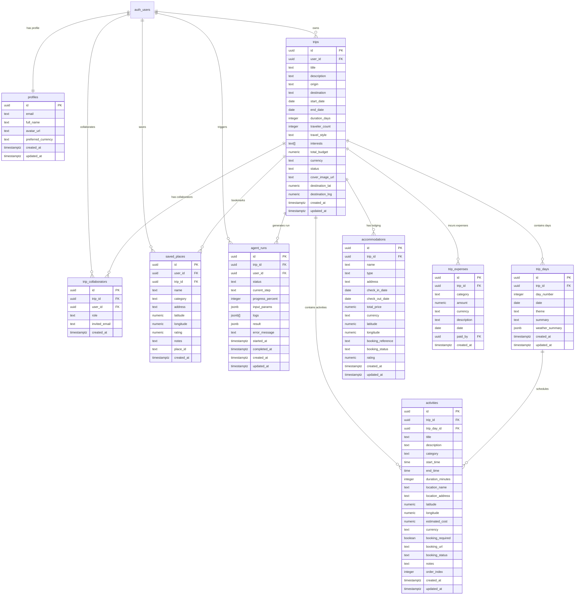

# TripPilot AI - Database Schema & Architecture Specification

> **Database Engine**: PostgreSQL 15+ (Supabase)  
> **Schema Migration**: [`supabase/migrations/20261022000000_init_schema.sql`](file:///D:/skills_lab/Travel_planner/supabase/migrations/20261022000000_init_schema.sql)  
> **Seed Data**: [`supabase/seed.sql`](file:///D:/skills_lab/Travel_planner/supabase/seed.sql)  
> **TypeScript Definitions**: [`backend/src/types/database.types.ts`](file:///D:/skills_lab/Travel_planner/backend/src/types/database.types.ts)  

---

## 1. Entity-Relationship Diagram (ERD)

---

## 2. Table Specifications & Constraints

### 2.1 `profiles`
Links 1:1 with Supabase Auth `auth.users`.
- `id` (UUID, Primary Key, Foreign Key to `auth.users(id) ON DELETE CASCADE`)
- `email` (TEXT, NOT NULL)
- `full_name` (TEXT, NULL)
- `avatar_url` (TEXT, NULL)
- `preferred_currency` (TEXT, DEFAULT `'USD'`)
- `created_at`, `updated_at` (TIMESTAMPTZ, DEFAULT `now()`)

### 2.2 `trips`
Top-level itinerary metadata and user planning preferences.
- `id` (UUID, Primary Key, DEFAULT `gen_random_uuid()`)
- `user_id` (UUID, FK `auth.users(id) ON DELETE CASCADE`)
- `title` (TEXT, NOT NULL)
- `origin`, `destination` (TEXT, NOT NULL)
- `start_date`, `end_date` (DATE, NOT NULL, CHECK `end_date >= start_date`)
- `duration_days` (INTEGER, CHECK `duration_days > 0`)
- `traveler_count` (INTEGER, CHECK `traveler_count > 0`, DEFAULT `1`)
- `travel_style` (TEXT, CHECK `IN ('budget', 'backpacking', 'balanced', 'cultural', 'luxury', 'adventure', 'relaxed')`)
- `interests` (TEXT[], DEFAULT `'{}'`)
- `total_budget` (NUMERIC(12, 2), CHECK `total_budget >= 0`)
- `currency` (TEXT, DEFAULT `'USD'`)
- `status` (TEXT, CHECK `IN ('draft', 'planning', 'confirmed', 'completed', 'cancelled')`)
- `destination_lat`, `destination_lng` (NUMERIC(10, 7))

### 2.3 `trip_collaborators`
Manages multi-user trip sharing and role permissions.
- `role`: `'owner'`, `'editor'`, or `'viewer'`.
- Unique constraint on `(trip_id, user_id)`.

### 2.4 `trip_days`
Represents individual calendar days within a trip.
- `day_number` (INTEGER, CHECK `day_number > 0`)
- `weather_summary` (JSONB) - Holds temperature max/min, rain probability, and weather condition string.
- Unique constraint on `(trip_id, day_number)`.

### 2.5 `activities`
Scheduled activities, attractions, landmarks, and meals for each day.
- `category`: `'sightseeing'`, `'dining'`, `'cultural'`, `'outdoor'`, `'transit'`, `'shopping'`, `'entertainment'`, `'relaxation'`.
- `start_time`, `end_time` (TIME, HH:MM).
- `duration_minutes` (INTEGER, CHECK `duration_minutes > 0`).
- `estimated_cost` (NUMERIC(10, 2), CHECK `>= 0`).
- `order_index` (INTEGER, DEFAULT 0).

### 2.6 `accommodations`
Hotel, hostel, resort, or apartment lodging details.
- `type`: `'hotel'`, `'hostel'`, `'resort'`, `'apartment'`, `'villa'`, `'other'`.
- `booking_status`: `'not_booked'`, `'reserved'`, `'confirmed'`.
- Enforces `check_out_date >= check_in_date`.

### 2.7 `trip_expenses`
Real-time budget tracker items.
- `category`: `'accommodation'`, `'flights'`, `'transport'`, `'activities'`, `'food'`, `'shopping'`, `'insurance'`, `'other'`.
- `amount` (NUMERIC(10, 2), CHECK `>= 0`).

### 2.8 `agent_runs`
Stores the execution lifecycle of autonomous agent runs for real-time frontend status polling.
- `status`: `'pending'`, `'running'`, `'completed'`, `'failed'`, `'cancelled'`.
- `progress_percent`: `0` to `100`.
- `current_step`: E.g. `'interpret'`, `'research'`, `'estimate_budget'`, `'generate_itinerary'`, `'validate'`, `'save'`, `'completed'`.
- `logs`: Array of JSON step logs with timestamps, tool names, and outputs.

---

## 3. Row Level Security (RLS) Matrix

RLS is enabled on **all 9 tables**. PostgreSQL enforces access controls at the database level:

| Table | Operation | Permission Rule |
|---|---|---|
| `profiles` | SELECT | Any authenticated user |
| `profiles` | INSERT / UPDATE | Only the owning user (`auth.uid() = id`) |
| `trips` | SELECT | Owner (`user_id = auth.uid()`) OR Collaborator (`is_trip_member`) |
| `trips` | INSERT | Authenticated user (`user_id = auth.uid()`) |
| `trips` | UPDATE | Owner OR Editor (`is_trip_editor`) |
| `trips` | DELETE | Owner only (`user_id = auth.uid()`) |
| `trip_days` | SELECT / ALL | Viewers can read; Editors and Owners can modify |
| `activities` | SELECT / ALL | Viewers can read; Editors and Owners can modify |
| `accommodations` | SELECT / ALL | Viewers can read; Editors and Owners can modify |
| `trip_expenses` | SELECT / ALL | Viewers can read; Editors and Owners can modify |
| `saved_places` | ALL | User owns record (`user_id = auth.uid()`) |
| `agent_runs` | ALL | User initiated run (`user_id = auth.uid()`) |

### Security Definer Helper Functions:
To eliminate infinite recursion loops during collaborator checks, two security-definer functions operate with elevated search paths:
- `is_trip_member(trip_id UUID, user_id UUID) -> BOOLEAN`
- `is_trip_editor(trip_id UUID, user_id UUID) -> BOOLEAN`
